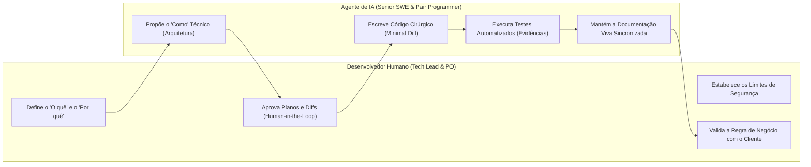

# 🧭 Playbook Metodológico de Condução do Agente de IA

> **Nome Oficial:** _The AI-Aided Software Engineering Playbook_  
> **Propósito:** Definir o método operacional exato para conduzir o agente de IA do "commit zero" até a entrega em produção, garantindo controle humano absoluto, qualidade técnica sênior e zero alucinação.

---

## 🎭 1. Filosofia de Atuação: O Modelo Tech Lead & Senior Pair

A colaboração com agentes de IA falha quando o humano se comporta como um mero espectador ou quando a IA é tratada como oráculo onisciente. O sucesso demonstrado no `nfse-nacional-api` é fruto de um modelo de **papeis bem definidos**:



---

## 🔄 2. O Ciclo de Vida em 5 Fases

```text
[FASE 1: Descoberta & ADR]  ──►  [FASE 2: Especificação SDD]  ──►  [FASE 3: TDD em Fatias]
            ▲                                                                │
            │                                                                ▼
[FASE 5: Evidência & Release] ◄── [FASE 4: Auditoria Multi-IA] ◄─────────────┘
```

---

### 📍 Fase 1: Descoberta & Decisão Arquitetural (ADR)

- **Quando acionar:** Antes de iniciar qualquer tecnologia nova, biblioteca de terceiros, padrão de persistência ou protocolo de transporte.
- **O que fazer:**
  1. O humano apresenta o problema e as restrições: _"Precisamos assinar XML com RSA-SHA256 em memória sem salvar arquivo em disco. Como podemos estruturar isso?"_
  2. O agente pesquisa alternativas, compara prós/contras e propõe a melhor abordagem.
  3. Formalizar a decisão em `docs/adrs/ADR-XXXX-[titulo].md` (usando o template refinado com gatilhos de reavaliação).
- **Regra de Ouro da Fase 1:** **Decisão registrada é decisão imutável.** A IA em sessões futuras não tem permissão para trocar a stack ou padrão sem uma nova ADR formal.

---

### 📍 Fase 2: Engenharia de Requisitos & Especificação (SDD)

- **Quando acionar:** Antes de escrever qualquer linha de código funcional.
- **O que fazer:**
  1. Instanciar `docs/specs/SPEC-XXXX-[nome-da-funcionalidade].md` a partir do template refinado.
  2. Mapear os **Requisitos Funcionais** com critérios BDD (_Dado / Quando / Então_).
  3. Mapear **Casos de Borda e Falhas (_Failure Modes_)**: o que acontece em timeout? Em dados malformados? Em duplicações?
  4. Definir os **Contratos de Interface** (payloads JSON/XML e códigos de status HTTP semânticos).
  5. Estruturar o **Plano de Execução em Fatias Verticais** (Fatia 1: Domínio -> Fatia 2: Core -> Fatia 3: Adaptador -> Fatia 4: Teste Integrado).
- **Regra de Ouro da Fase 2:** **O agente não escreve código sem uma spec ativa com critérios de aceite aprovados pelo humano.**

---

### 📍 Fase 3: Implementação Cirúrgica em Fatias Verticais (TDD)

- **Quando acionar:** Durante a construção da funcionalidade.
- **Como conduzir o agente:**
  1. **Apresentar o Plano Curto:** O agente apresenta as 3 a 5 modificações exatas que fará para a fatia atual.
  2. **Aprovação Explícita (_Human-in-the-Loop_):** O humano responde _"ok"_ ou refina o plano antes que qualquer arquivo seja tocado.
  3. **Edição Cirúrgica (_Minimal Diff_):** O agente altera apenas o bloco estritamente necessário. Nunca reescreve arquivos inteiros nem apaga código não relacionado.
  4. **Implementação Completa (_Anti-Lazy Code_):** Proibição total de `// ... restante do código`.
  5. **Execução Imediata de Testes:** O agente roda `./mvnw test` e só considera a fatia concluída se a suíte estiver 100% verde.
  6. **Commit Atômico com Conventional Commits:** Exemplo: `feat(core): validar coerencia estrita do id da dps`.

---

### 📍 Fase 4: Auditoria Cruzada & Revisão Multi-IA (Multi-Model Review)

- **Quando acionar:** Ao concluir um épico ou estabilizar um marco (ex: antes de ir para homologação).
- **Como conduzir a revisão:**
  1. Exportar ou submeter o repositório a um segundo modelo de IA (ex: Claude 3.5 Sonnet, GPT-4o, DeepSeek ou Gemini) com um prompt de auditoria fria.
  2. Estruturar a análise utilizando o template `docs/templates/ANALYSIS-AI.md`.
  3. O modelo auditor avalia:
     - Vulnerabilidades de segurança (XXE, injeção de logs, credenciais).
     - Vazamento de recursos (conexões abertas, falta de bounds em caches estáticos).
     - Integridade de concorrência e threads.
     - Aderência da documentação com o código real.
  4. Agrupar os achados em 🔴 Alto, 🟠 Médio e 🟡 Baixo.
  5. Planejar as correções cirúrgicas, executá-las via Fase 3 e formalizar o documento `-concluded.md`.

---

### 📍 Fase 5: Conclusão Baseada em Evidências & Release

- **Quando acionar:** Antes de criar a tag de release ou realizar o deploy.
- **Checklist de Fechamento (_Definition of Done_):**
  - [ ] Build completo e limpo (`mvn clean compile`).
  - [ ] Suíte de testes 100% verde (`mvn clean test`).
  - [ ] Varredura do Gitleaks sem nenhum segredo ou dado de cliente detectado.
  - [ ] Inspeção de dependências sem vulnerabilidades críticas (OWASP).
  - [ ] `docs/backlog.md` atualizado com as tarefas marcadas como 🟢 `[Concluído]`.
  - [ ] `README.md` e OpenAPI sincronizados com o código entregue.
  - [ ] GitHub Actions CI verde na branch `main`.

---

## 🗣️ 3. Boas Práticas de Comunicação & Engenharia de Prompts

Para extrair máxima produtividade e qualidade do agente:

| Situação          | Prompt Incorreto (Vago / Arriscado) ❌       | Prompt Correto (Direcionado e Seguro) ✅                                                                                                                                           |
| :---------------- | :------------------------------------------- | :--------------------------------------------------------------------------------------------------------------------------------------------------------------------------------- |
| **Nova Feature**  | _"Crie a emissão de notas fiscais pra mim."_ | _"Consulte a `SPEC-001.md`. Implemente a Fatia 2 (método `assinar(xml, cert)` no `AssinadorDpsService`). Apresente o plano e os testes unitários antes de editar."_                |
| **Refatoração**   | _"Melhore esse controller que tá feio."_     | _"No `LegacySoapController`, substitua a decodificação global de entidades por decodificação condicional apenas quando `<DPS` não estiver presente. Preserve o resto do arquivo."_ |
| **Erro de Teste** | _"Deu erro no teste, conserta aí."_          | _"O teste `deveValidarAssinatura` falhou com `XMLSignatureException` na linha 42. Analise a causa raiz no log do Surefire e proponha a correção cirúrgica."_                       |
| **Auditoria**     | _"O que você acha do meu código?"_           | _"Atue como Engenheiro de Segurança Sênior. Analise o `CertificadoProvider.java` procurando potenciais vazamentos de memória, falta de `close()` e concorrência."_                 |

---

## 🧠 4. Gestão de Contexto e Prevenção de Amnésia da IA

1. **Sessões Focadas em um Único Tópico:** Nunca tente resolver uma spec inteira, um refactor de infraestrutura e uma limpeza de documentação na mesma sessão. Mantenha uma tarefa por conversa.
2. **Docs como Memória Externa:** O agente tem janela de contexto finita. Sempre que um ponto importante for decidido, **escreva no disco** (`ADR`, `SPEC` ou `backlog.md`). O arquivo em disco é a memória de longo prazo da IA.
3. **Comandos em Background e Assíncronos:** Comandos longos (como builds Maven ou suítes de testes pesadas) devem rodar de forma assíncrona com monitoramento de conclusão, sem bloquear a linha de raciocínio.

---

### 🎯 Conclusão da Trilogia de Engenharia

Com a conclusão destas 3 etapas, estabelecemos um ecossistema completo:

1. **Etapa 1:** Os 5 Templates Refinados e Integrados em `docs/templates/`.
2. **Etapa 2:** O Desenho Canônico e o Scaffolding Inteligente do `project-starter-kit`.
3. **Etapa 3:** O Playbook Metodológico de Condução Operacional do Agente de IA.
