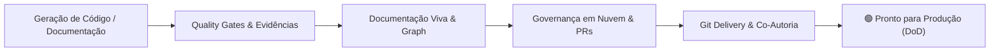

# ✅ Protocolo de Conclusão de Tarefas & Checklist Pós-Implementação

> **Definition of Done (DoD) Operacional para Engenharia de Software Assistida por IA**  
> Repositório: [`heviane/project-starter-kit`](https://github.com/heviane/project-starter-kit) &bull; Diretório: `docs/`  
> Documentos Relacionados: [`playbook-engenharia-ia.md`](./playbook-engenharia-ia.md) &bull; [`guia-seguranca-agentes-ia.md`](./guia-seguranca-agentes-ia.md) &bull; [`glossario-engenharia.md`](./glossario-engenharia.md) &bull; [`AGENTS.md`](../AGENTS.md)

---

## 📌 1. Propósito & Filosofia: DoD Operacional da IA

No paradigma de **Engenharia de Software Assistida por Inteligência Artificial (AI-SEP)**, a conclusão de uma tarefa de código ou documentação **nunca** se encerra no momento em que o modelo finaliza a geração textual no prompt.

Existe uma fronteira nítida entre o código *"gerado pelo modelo"* e o incremento *"pronto para produção"*:



Este documento estabelece o **Protocolo Compulsório de 4 Fases** que qualquer agente de inteligência artificial (Google Antigravity, GitHub Copilot, Claude Code, Cursor, Windsurf) ou par desenvolvedor humano deve executar sistematicamente antes de declarar qualquer tarefa concluída.

Adicionalmente, este protocolo atua como a **Régua de Auditoria e Scorecard de Modernização** para orientar a análise técnica, governança e refatoração de repositórios legados do ecossistema criados antes do template canônico.

---

## ⚖️ 2. Matriz de Proporcionalidade do DoD (Por Tipo de Tarefa)

Para garantir máxima agilidade sem comprometer a qualidade e a segurança, os critérios de conclusão do DoD devem ser aplicados com **estrita proporcionalidade ao escopo da alteração**:

| Tipo de Alteração | Fases & Critérios Obrigatórios do DoD | Critérios Dispensáveis |
| :--- | :--- | :--- |
| **Documentação pura (`.md`)** | Linters de Markdown (`markdownlint-cli2`), verificação de links, tolerância zero a placeholders órfãos e *Docs-as-Code* (`docs/backlog.md` ou `CHANGELOG.md` se aplicável). | Execução de build de binários e suíte de testes unitários de código funcional. |
| **Scripts e automações (`.sh`, `.ps1`)** | Linters de script (`shellcheck`, parsers AST), testes funcionais em sandbox temporário (`$env:TEMP` / `/tmp`), *Sandbox Hygiene* e *Safe CLI*. | Build de código de aplicação comercial. |
| **Código funcional (`src/`, `lib/`)** | Suíte de testes 100% verde (`Evidence-Based Completion`), *Anti-Test Tampering*, compilação e build determinísticos limpos e linters de linguagem. | - |
| **Segurança e dependências** | Varredura Gitleaks (*Zero Secrets*), integridade de lockfiles e auditoria de vulnerabilidades/SCA. | - |
| **Infraestrutura e CI/CD** | Validação sintática de workflows (`.github/workflows/`), testes de simulação e checagem de concorrência. | - |

> 💡 *Nota Universal: A aprovação prévia humana (Human-in-the-Loop), Zero Secrets & Host Privacy, Conventional Commits e commits atômicos são universais e inegociáveis para qualquer tipo de alteração.*

---

## 📋 3. O Protocolo Mestre em 4 Fases (Definition of Done)

Toda tarefa concluída deve satisfazer os critérios objetivos distribuídos nas quatro fases a seguir:

---

### 🛡️ Fase 1: Quality Gates & Evidências Empíricas (Code & Quality)

Esta fase assegura a robustez funcional, ausência de regressões e integridade de segurança do código-fonte antes de qualquer integração.

- [ ] **1.1. Suíte de Testes 100% Verde (Evidence-Based Completion):**
  - Todos os testes unitários, integrados ou de contrato foram executados no terminal via CLI nativa do projeto (`mvn test`, `npm test`, `dotnet test`, `Invoke-Pester`).
  - O agente coletou e apresentou a evidência real de saída do terminal confirmando zero falhas.
- [ ] **1.2. Integridade Inviolável de Testes (*Anti-Test Tampering*):**
  - Nenhuma asserção de teste existente foi afrouxada, comentada, suprimida ou modificada para mascarar erros de implementação.
  - Se um teste falhou, a causa raiz no código funcional (`src/`) foi identificada e corrigida cirurgicamente.
- [ ] **1.3. Linters e Verificação Estática de Sintaxe:**
  - Código-fonte e documentação aderem estritamente aos linters do projeto (`eslint`, `shellcheck`, `markdownlint-cli2`, AST parsers).
  - Zero erros de sintaxe ou violações de estilo de código.
- [ ] **1.4. Compilação e Build Limpos:**
  - O projeto compila determinística e integralmente sem *warnings* críticos (`npm run build`, `mvn clean compile`, `dotnet build`).
- [ ] **1.5. Varredura Preventiva de Segredos & Privacidade (*Zero Secrets & Host Privacy*):**
  - Nenhuma credencial, chave de API, certificado, token ou senha foi introduzida em código, testes ou documentação.
  - Nenhum caminho físico absoluto local do host (ex.: letras de unidades `C:\`, `E:\` ou diretórios internos de usuário) foi exposto; utilização estrita de caminhos relativos ou marcadores conceituais (`<workspace-root>`, `<cloud-vault>`).
  - Execução de varredura automatizada com Gitleaks (`gitleaks dir . --config .gitleaks.toml`).

---

### 📚 Fase 2: Documentação Viva & Grafo de Conhecimento (Docs-as-Code)

Esta fase combate a deterioração documental (*doc rot*) e mantém todos os artefatos de governança perfeitamente sincronizados no mesmo ciclo de trabalho.

- [ ] **2.1. Backlog de Entregas (`docs/backlog.md`):**
  - O item correspondente foi atualizado para o status concluído `🟢`.
  - Os critérios de aceite foram evidenciados e marcados.
- [ ] **2.2. Glossário de Engenharia (`docs/glossario-engenharia.md`):**
  - Avaliação de novos termos: se a tarefa introduziu um novo padrão arquitetural, biblioteca, termo de negócio ou sigla técnica, o verbete canônico foi adicionado no glossário.
- [ ] **2.3. Playbook de Engenharia de IA (`docs/playbook-engenharia-ia.md`):**
  - Se a tarefa refinou uma dinâmica de prompt, fase de condução, armadilha operacional ou heurística metodológica, o playbook foi atualizado para registrar a lição aprendida.
- [ ] **2.4. Histórico de Mudanças (`CHANGELOG.md`):**
  - Caso o repositório possua versão formal ou entrega de produto, registrar a modificação sob a seção `[Unreleased]` ou na versão correspondente, seguindo o padrão *Keep a Changelog* e *SemVer*.
- [ ] **2.5. Prevenção de Deterioração Documental (*Anti-Doc Rot*):**
  - Nenhum trecho extenso de código-fonte foi duplicado na documentação técnica. A documentação explica as regras de negócio e a arquitetura, referenciando o código real via links relativos.
- [ ] **2.6. Eliminação de Código Morto (*Zero Zombie Code*):**
  - Remoção cirúrgica de funções comentadas, variáveis órfãs, scripts de rascunho abandonados e métodos depreciados.
- [ ] **2.7. Interligação Bidirecional de Documentos (*Graph Interconnection*):**
  - Novos arquivos de documentação criados possuem links cruzados apontando para artefatos adjacentes e são referenciados nos índices ou sumários correspondentes.
- [ ] **2.8. Nomenclatura Canônica em Inglês:**
  - Todos os arquivos e diretórios novos foram nomeados estritamente em **inglês** no formato `kebab-case` (`docs/post-implementation-checklist.md`).

---

### ☁️ Fase 3: Governança em Nuvem & Auditoria de Dependências (Cloud Governance)

Esta fase garante que a governança do repositório Git esteja perfeitamente espelhada nas ferramentas de gestão em nuvem e que dependências externas estejam seguras.

- [ ] **3.1. Sincronização Contínua com GitHub Projects / Kanban (se configurado):**
  - Havendo alteração de status, prioridade ou inclusão de novos itens no backlog (`docs/backlog.md`), mantenha o quadro de acompanhamento do projeto devidamente atualizado (via CLI `gh project`, automação própria ou atualização manual no quadro do repositório).
  - Prevenção ativa de *drift* entre os arquivos Git locais e o quadro executivo (GitHub Projects ou Kanban adotado).
- [ ] **3.2. Auditoria Contínua de Pull Requests e Dependências Remotas:**
  - Inspeção de PRs remotos pendentes via CLI do GitHub:

    ```bash
    gh pr list
    ```

  - Se houver PRs automatizados (Dependabot, atualizações de GitHub Actions) com CI 100% verde e sem quebra de compatibilidade, planejar a incorporação via *Squash Merge* e sincronização do working tree local (`git pull`).

---

### 🚀 Fase 4: Entrega Git & Rastreabilidade (Git Delivery & Audit Trail)

Esta fase consolida a entrega com rastreabilidade formal, integridade de histórico e preservação de autoria.

- [ ] **4.1. Aprovação Prévia da Liderança Humana (*Human-in-the-Loop*):**
  - O plano de mudanças, o resumo dos arquivos modificados e as evidências de teste foram apresentados e explicitamente aprovados pela pessoa desenvolvedora.
- [ ] **4.2. Commit Atômico & Responsabilidade Única (*Single-Purpose Commit*):**
  - O commit agrupa estritamente as alterações de um único propósito lógico. Proibido misturar refatoração de código com atualização de dependências ou adição de features com correções estéticas.
- [ ] **4.3. Conformidade com *Conventional Commits*:**
  - Mensagem padronizada em inglês e no modo imperativo:

    ```text
    <tipo>(<escopo>): <descrição curta no imperativo em inglês>

    [corpo opcional explicando o motivo]

    [rodapé com co-autoria ou issues vinculadas]
    ```

- [ ] **4.4. Rastreabilidade de IA & Co-Autoria Obrigatória (*Git Co-Authorship*):**
  - Inclusão compulsória do trailer no rodapé do commit para qualquer entrega gerada ou assistida por IA (utilizando a identidade canônica do assistente ativo, ex.: `Google Antigravity <antigravity[bot]@google.com>`, `Claude <noreply@anthropic.com>` ou `GitHub Copilot <copilot@github.com>`):

    ```text
    Co-authored-by: [NOME_DO_AGENTE] <[EMAIL_DO_AGENTE]>
    ```

- [ ] **4.5. Limpeza de Árvore e Push Seguro:**
  - Verificação de estado limpo do repositório (`git status -s` sem arquivos untracked indesejados).
  - Envio dos commits para a branch remota (`git push`).

---

## 🎯 3. Régua de Auditoria & Scorecard para Repositórios Legados (Pré-Starter Kit)

Para os repositórios criados antes da consolidação do `project-starter-kit`, este checklist serve como uma **Régua de Maturidade e Scorecard de Gap Analysis** para orientar o plano de modernização gradual:

### Níveis de Maturidade de Repositório

| Nível de Maturidade | Classificação | Critérios Atendidos do Protocolo | Ação de Modernização Recomendada |
| :--- | :--- | :--- | :--- |
| **Nível 1** | 🔴 *Legado Básico* | Apenas código compila. Sem testes automatizados, sem `AGENTS.md`, sem backlog estruturado. | Adicionar `AGENTS.md` canônico, `README.md` estruturado e pipeline mínimo de CI com linters. |
| **Nível 2** | 🟡 *Em Transição* | Possui testes básicos e `README.md`, mas carece de `AGENTS.md`, backlog Docs-as-Code e varredura de segredos. | Instanciar governança do Starter Kit (`AGENTS.md`, `docs/backlog.md`, `.gitleaks.toml`). |
| **Nível 3** | 🟢 *Governança Ativa* | Possui `AGENTS.md` alinhado, testes automatizados verdes, CI com Gitleaks e backlog sincronizado com GitHub Projects / Kanban. | Refinar documentação viva (`glossario-engenharia.md`, `playbook-engenharia-ia.md`) e convenções de commit. |
| **Nível 4** | 💎 *AI-SEP Total* | Conformidade integral com as 4 Fases do DoD: suíte verde, anti-tampering, docs vivas, GitHub Projects / Kanban, co-autoria e zero segredos. | Manter paridade contínua e incorporar novas práticas do ecossistema. |

### Matriz Rápida de Diagnóstico (Gap Analysis)

Ao abrir uma sessão de auditoria em um repositório pré-starter kit, preencha este diagnóstico rápido:

```text
[ ] 1. Possui AGENTS.md aderente às Regras de Ouro Universais?
[ ] 2. Possui docs/backlog.md integrado com GitHub Projects / Kanban?
[ ] 3. Possui pipeline de CI com testes automatizados e Gitleaks?
[ ] 4. Possui documentação viva (glossário, specs, adrs)?
[ ] 5. Aplica Conventional Commits com trailer de Co-authored-by?
```

---

## ⚡ 4. Checklist Rápido de Bolso (Copy-Paste para PRs e Issues)

Utilize este bloco sintetizado na descrição de Pull Requests ou fechamento de sessões de pareamento:

```markdown
### ✅ Checklist de Fechamento (Definition of Done)

- [ ] **Quality Gates:** Testes automatizados executados e 100% verdes (evidência anexada).
- [ ] **Anti-Tampering:** Nenhuma asserção de teste foi relaxada ou suprimida.
- [ ] **Linters & Build:** Validação estática sem erros e build determinístico limpo.
- [ ] **Zero Secrets:** Varredura preventiva com Gitleaks sem segredos ou credenciais.
- [ ] **Docs-as-Code:** Backlog atualizado para 🟢 Concluído e critérios de aceite validados.
- [ ] **Documentação Viva:** Glossário, Playbook ou Changelog atualizados (se aplicável).
- [ ] **Cloud Sync:** Sincronização executada com o GitHub Project / Kanban (se configurado).
- [ ] **Git Delivery:** Commit atômico em Conventional Commits com trailer `Co-authored-by`.
```

---

## 🔗 5. Grafo de Rastreabilidade & Conexões

- 🧭 **Metodologia de Condução:** [`docs/playbook-engenharia-ia.md`](./playbook-engenharia-ia.md)
- 🛡️ **Guia de Segurança & Guardrails:** [`docs/guia-seguranca-agentes-ia.md`](./guia-seguranca-agentes-ia.md)
- 📖 **Conceitos & Nomenclaturas:** [`docs/glossario-engenharia.md`](./glossario-engenharia.md)
- 📑 **Catálogo de Modelos:** [`docs/templates/README.md`](./templates/README.md)
- 🤖 **Contrato Operacional de IA:** [`AGENTS.md`](../AGENTS.md)
