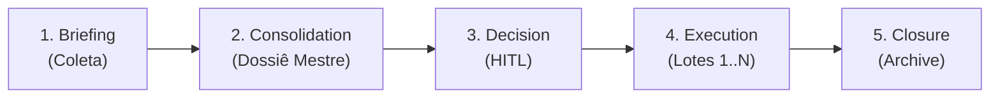

# 🔍 Multi-Agent Review Framework (MARF)

> **Manual de Governança e Melhores Práticas para Auditorias com Múltiplos Modelos de IA**  
> **Status:** `Ativo` | **Padrão:** `AI-SEP Starter Kit`

---

## 📌 1. Por que usar Múltiplos Modelos de IA?

Diferentes modelos de Inteligência Artificial possuem forças cognitivas e vieses complementares:

* **ChatGPT (OpenAI):** Excelente visão de produto, usabilidade, estratégia e modularidade de arquitetura.
* **Claude (Anthropic):** Alto rigor analítico, precisão técnica cirúrgica, identificação de inconsistências documentais e rastreamento de detalhes em regras de negócio.
* **GitHub Copilot (Microsoft):** Pragmatismo focado em ergonomia de código, padrões de ecossistema e pipelines.
* **Google Antigravity:** Orquestração de ambiente, execução iterativa em lotes, validação via terminal e consolidação trilateral.

O **MARF** combina essas forças em um fluxo ordenado que evita opiniões isoladas e elimina alucinações por meio de **confronto crítico e validação humana (*Human-in-the-Loop*)**.

---

## 🔄 2. O Ciclo Operacional em 5 Fases



### Fase 1: Briefing & Coleta Divergente (Review)

1. Crie um documento de briefing com o contexto, propósito, stack e escopo da análise utilizando o modelo [`docs/reviews/templates/REVIEW_BRIEFING_TEMPLATE.md`](./templates/REVIEW_BRIEFING_TEMPLATE.md).
2. Submeta o mesmo briefing de forma independente para 2 ou mais modelos de IA.
3. Registre os retornos brutos utilizando o template [`docs/reviews/templates/AI_REVIEW_TEMPLATE.md`](./templates/AI_REVIEW_TEMPLATE.md).

### Fase 2: Síntese & Confronto Crítico (Consolidation)

1. O agente orquestrador/consolidador lê todos os pareceres simultaneamente.
2. Monta uma **Matriz de Confronto Trilateral** identificando:
   * **Consensos Unânimes:** Ações prioritárias apontadas por todos os modelos.
   * **Divergências Conceituais:** Pontos onde os modelos sugerem caminhos opostos.
   * **Achados Exclusivos:** Bugs ou riscos específicos detectados por apenas um agente.
3. Estrutura o **Plano de Ação Mestre** fatiado em **Lotes Dinâmicos (`Lote 1..N`)** utilizando o modelo [`docs/reviews/templates/MASTER_ACTION_PLAN_TEMPLATE.md`](./templates/MASTER_ACTION_PLAN_TEMPLATE.md).

### Fase 3: Alinhamento Human-in-the-Loop (Decision)

1. A pessoa desenvolvedora avalia o dossiê consolidado.
2. Resolve eventuais divergências entre os modelos e autoriza o início da execução.

### Fase 4: Execução Iterativa em Lotes (Execution)

1. O agente implementa um lote de cada vez.
2. Roda validações locais automáticas (linters, suítes de testes, builds).
3. Submete a proposta formal de commit e diff para aprovação humana antes de qualquer push.

### Fase 5: Encerramento & Arquivamento (Closure)

1. Atualiza a matriz de rastreabilidade (100% concluída).
2. Move os artefatos do ciclo para a pasta de histórico (`archive/`).

---

## 🗂️ 3. Estrutura Recomendada de Pastas

Para manter o ambiente de trabalho desacoplado e limpo:

```text
reviews/
├── README.md                      # Guia do processo no projeto
├── templates/                     # Modelos oficiais do MARF
│   ├── REVIEW_BRIEFING_TEMPLATE.md
│   ├── AI_REVIEW_TEMPLATE.md
│   └── MASTER_ACTION_PLAN_TEMPLATE.md
├── active/                        # Revisão ou auditoria em andamento
└── archive/                       # Histórico de auditorias finalizadas
    ├── 001-<data>-<alvo>/
    └── 002-<data>-<alvo>/
```

> **Nota de Segurança:** Caso as análises contenham dados sensíveis, logs de produção ou dados reais de clientes, armazene a pasta `reviews/` em uma unidade externa privada/em nuvem com backup seguro, em conformidade com o princípio de segregação física de segredos.

---

## 🔗 4. Grafo de Rastreabilidade & Conexões

* 🤖 **Contrato Operacional de IA:** [`AGENTS.md`](../../AGENTS.md)
* 📑 **Catálogo Geral de Modelos:** [`docs/templates/README.md`](../templates/README.md)
* 🧭 **Metodologia de Condução:** [`docs/playbook-engenharia-ia.md`](../playbook-engenharia-ia.md)
* 📖 **Glossário de Engenharia:** [`docs/glossario-engenharia.md`](../glossario-engenharia.md)
* ✅ **Protocolo de Conclusão (DoD):** [`docs/post-implementation-checklist.md`](../post-implementation-checklist.md)
