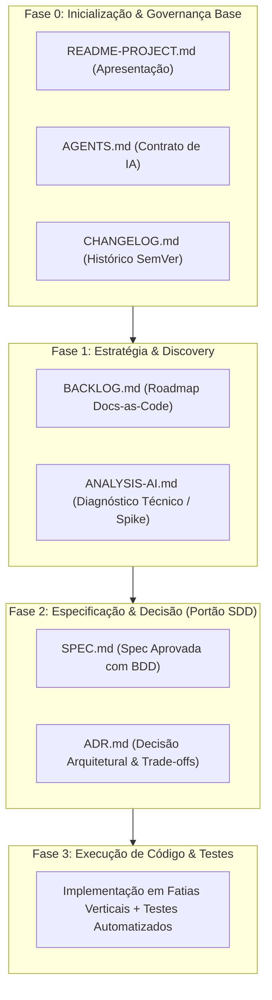

# 📑 Catálogo de Modelos & Templates de Governança (AI-SEP)

> **Padrões Canônicos de Engenharia de Software, Spec-Driven Development (SDD) e Docs-as-Code**  
> Repositório: [`heviane/project-starter-kit`](https://github.com/heviane/project-starter-kit) &bull; Diretório: `docs/templates`  
> Status: `Ativo & Padronizado`

---

## 📌 1. Visão Geral

Este diretório centraliza a biblioteca oficial de modelos e templates estruturados do ecossistema `@heviane`.

Eles foram projetados sob os princípios da plataforma **AI-SEP (AI-Assisted Software Engineering Platform)** e **Docs-as-Code**, servindo tanto para orientar o trabalho de desenvolvedores humanos quanto para atuar como contratos operacionais de contexto, especificação e qualidade para **Agentes de Inteligência Artificial** (GitHub Copilot, Antigravity, Claude Code, Cursor, Windsurf).

---

## 🧭 2. Catálogo Oficial de Templates

| Template | Finalidade Técnica & Metodológica | Destino Canônico no Projeto | Frequência de Instanciação |
| :--- | :--- | :--- | :--- |
| **[`SPEC.md`](./SPEC.md)** | Especificação de funcionalidade orientada a requisitos (SDD), com fatias verticais, cenários BDD/Gherkin e modos de falha. | `docs/specs/SPEC-[NUM]-[slug].md` | Contínua (a cada novo épico ou feature complexa). |
| **[`ADR.md`](./ADR.md)** | Registro de Decisões Arquiteturais (*Architecture Decision Records*), formalizando contexto, forças, alternativas avaliadas e gatilhos de revisão. | `docs/adrs/[NUM]-[slug].md` | Contínua (a cada decisão técnica estrutural relevante). |
| **[`AGENTS.md`](./AGENTS.md)** | Contrato operacional mestre para Agentes de IA, estabelecendo o papel do agente, as Regras de Ouro (*Human-in-the-Loop*, *Minimal Diff*, etc.) e diretrizes de domínio. | `AGENTS.md` (na raiz do projeto) | Inicial (no setup do repositório) e atualizado continuamente. |
| **[`BACKLOG.md`](./BACKLOG.md)** | Planejamento ágil versionado em Git (*Docs-as-Code*), contendo taxonomia padronizada de IDs (`SET-`, `CORE-`, `API-`, `OPS-`), status e matriz de entregas. | `docs/backlog.md` | Inicial (no setup) e atualizado a cada avanço no roadmap. |
| **[`ANALYSIS-AI.md`](./ANALYSIS-AI.md)** | Diagnóstico técnico, auditoria de código-fonte e matriz de riscos executada por modelos de IA para tarefas de *Discovery* ou avaliação de maturidade. | `docs/analises/[YYYY-MM-DD]-[modelo].md` ou cofre de auditoria | Sob demanda (ao iniciar diagnósticos pontuais). |
| **[`README-PROJECT.md`](./README-PROJECT.md)** | Modelo canônico para o `README.md` de apresentação do projeto, abrangendo propósito, stack tecnológica, arquitetura e instruções rápidas. | `README.md` (na raiz do projeto) | Inicial (gerado durante o processo de bootstrapping). |
| **[`CHANGELOG.md`](./CHANGELOG.md)** | Histórico padronizado de mudanças e versões de software, baseado nas convenções *Keep a Changelog* e *Versionamento Semântico (SemVer)*. | `CHANGELOG.md` (na raiz do projeto) | Inicial (no setup) e atualizado a cada nova tag/release. |

---

## 🔄 3. Ciclo de Vida: Quando Utilizar Cada Modelo?

Os templates organizam o fluxo de trabalho de engenharia de forma ordenada:



1. **Setup Inicial (Dia 0):** Ao criar um repositório, os arquivos `README-PROJECT.md`, `AGENTS.md`, `BACKLOG.md` e `CHANGELOG.md` são instanciados e personalizados.
2. **Planejamento de Épicos:** Novas demandas nascem no `docs/backlog.md`. Se houver incerteza técnica, realiza-se uma análise prévia com `ANALYSIS-AI.md`.
3. **Portão de Especificação (SDD):** Antes de codificar qualquer funcionalidade, copia-se `SPEC.md` para `docs/specs/SPEC-XXX.md`. A codificação só é iniciada após o status atingir `Aprovado para Implementação`.
4. **Decisões Estruturais:** Se a implementação envolver trade-offs de bibliotecas, persistência, mensageria ou segurança, registra-se uma decisão com `ADR.md`.
5. **Entrega & Release:** Ao fechar a entrega, o `CHANGELOG.md` e o `docs/backlog.md` são atualizados no mesmo ciclo de commit.

---

## 🔍 4. Auditorias Multi-Agente: Módulo MARF

Para auditorias e revisões arquiteturais cruzadas conduzidas com múltiplos modelos de IA (**ChatGPT**, **Claude**, **GitHub Copilot** e **Google Antigravity**), utilize o módulo dedicado:

👉 **[Multi-Agent Review Framework (MARF)](../reviews/README.md)**

Seus modelos especializados estão localizados em [`docs/reviews/templates/`](../reviews/templates/):

- **`REVIEW_BRIEFING_TEMPLATE.md`:** Prompt e briefing base enviado de forma independente aos modelos.
- **`AI_REVIEW_TEMPLATE.md`:** Parecer técnico individualizado por modelo.
- **`MASTER_ACTION_PLAN_TEMPLATE.md`:** Dossiê Mestre com Matriz de Confronto Trilateral e Lotes Dinâmicos (`Lote 1..N`).

---

## 🚀 5. Como Instanciar os Modelos

### 5.1. Via Script de Inicialização Inteligente (Recomendado)

Ao criar um repositório a partir deste starter kit, execute o assistente de inicialização:

- **No Windows (PowerShell):**

  ```powershell
  .\scripts\bootstrap.ps1
  ```

- **No Linux / macOS (Bash):**

  ```bash
  chmod +x ./scripts/bootstrap.sh
  ./scripts/bootstrap.sh
  ```

O assistente hidrata automaticamente os templates iniciais com os dados do novo projeto e os move para os seus destinos canônicos.

### 5.2. Cópia Manual Contínua durante o Desenvolvimento

Para adicionar novas especificações, decisões ou análises durante o ciclo de vida do projeto:

```bash
# Adicionar nova especificação funcional (SDD)
cp docs/templates/SPEC.md docs/specs/SPEC-001-nome-da-feature.md

# Adicionar novo registro de decisão arquitetural (ADR)
cp docs/templates/ADR.md docs/adrs/001-escolha-do-banco-de-dados.md

# Adicionar nova análise técnica de IA
cp docs/templates/ANALYSIS-AI.md docs/analises/2026-11-22-diagnostico-inicial.md
```

---

## 🛡️ 6. Diretrizes de Governança para Edição dos Templates

1. **Agnóstico de Tecnologia:** Mantenha os templates neutros, evitando acoplamento rígido a linguagens, frameworks ou provedores de nuvem específicos.
2. **Compatibilidade com Bootstrap:** Qualquer alteração nos campos de substituição de `README-PROJECT.md`, `AGENTS.md`, `BACKLOG.md` ou `CHANGELOG.md` deve manter estrita paridade com a lógica dos scripts `bootstrap.ps1` e `bootstrap.sh`.
3. **Docs-as-Code:** Toda alteração estrutural nos modelos deve ser documentada neste catálogo e acompanhada do respectivo commit semântico.
4. **Marcadores Canônicos (`[UPPER_SNAKE_CASE]`):** Todos os campos a serem preenchidos por pessoas desenvolvedoras ou agentes de IA utilizam marcadores canônicos padronizados em caixa alta entre colchetes (ex.: `[NOME_DO_PROJETO]`, `[DESCRICAO_DO_PROJETO]`, `[ORGANIZACAO_OU_USUARIO]`, `[TECNOLOGIAS_UTILIZADAS]`), garantindo busca imediata no editor e substituição blindada em automações.
